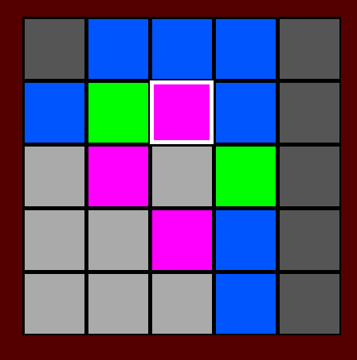

   

# PLAY

Play the game on https://vga-playground.com/?repo=https://github.com/Edgarol99/minesweeperUABC

## HOW TO PLAY

Move the player with the arrows of the pad, 
press A to reveal the cell,
each tile color indicates how many mines are around
gray    -> 0
blue    -> 1
green   -> 2
red     -> 3
purple  -> 4
cyan    -> 5
yellow  -> 6
orange  -> 7

If you press a mine you LOSE!!.. 
..an you can continue playing pressing A again
Good Luck!!!! (sometimes is needed)

# What is Tiny Tapeout?

Tiny Tapeout is an educational project that aims to make it easier and cheaper than ever to get your digital and analog designs manufactured on a real chip.

To learn more and get started, visit https://tinytapeout.com.

## Resources

- [FAQ](https://tinytapeout.com/faq/)
- [Digital design lessons](https://tinytapeout.com/digital_design/)
- [Learn how semiconductors work](https://tinytapeout.com/siliwiz/)
- [Join the community](https://tinytapeout.com/discord)
- [Build your design locally](https://www.tinytapeout.com/guides/local-hardening/)
